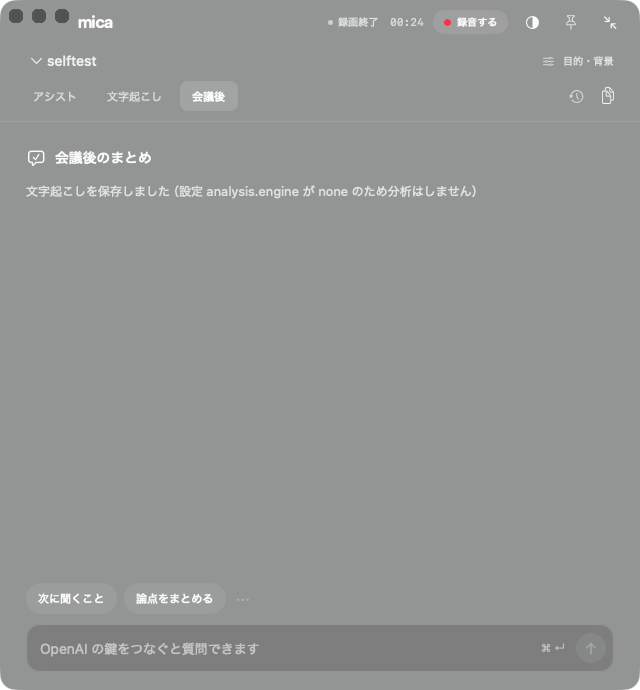

# Mica

Mac の会議アシスタントです。会議が始まると自動で録り、Mac の中で文字に起こし、終わると記録を残します。
鍵もアカウントも無しで動きます。OpenAI や Claude をつなぐと、つないだ分だけ機能が増えます。



## できること

| 段 | つなぐ物 | 増える機能 |
|---|---|---|
| 1 | なし | 録音と録画、Mac の中の文字起こし、自分と相手の区別、記録の保存 |
| 2 | OpenAI の API の鍵 | 会議中の助言と質問、文字起こしの2重確認（API の認識と Mac の中の認識を比べる） |
| 3 | Claude（契約か API の鍵） | 会議後の分析（結論・決まったこと・次やること。発言の引用つき） |

- Zoom・Google Meet・Teams・Slack ハドルなど、アプリがマイクを使い始めると録り始めます。相手が主催の会議も録れます。
- 対面の会議は Mica の［録音する］で録ります。
- 段1では音声も文字も Mac の外へ出ません。

## 要る物

- Apple シリコンの Mac、macOS 26 以上
- Xcode のコマンドラインツール（`xcode-select --install`）
- [uv](https://docs.astral.sh/uv/) と ffmpeg（`brew install uv ffmpeg`）
- 空き容量 約3GB（音声認識のモデル 約1.6GB を含む）

## 入れ方

```bash
git clone https://github.com/furuchanchan/mica.git
cd mica
./install.sh
```

`install.sh` は次の4つを入れ、常駐を2つ起こします。何度動かしても構いません。

1. 音声認識と話者分けの実行環境（`~/Library/Application Support/Mica` の下。モデルは配布元から取ります）
2. 録画アプリ `MicaRecorder.app`
3. サービス（見張り役と音声認識）
4. `~/Applications/Mica.app`

最初の会議で、macOS が `MicaRecorder` に「画面とシステムオーディオ録音」と「マイク」の許可を求めます。許可すると次から録れます。
手元でビルドするので、アプリを作り直すと許可が外れることがあります。外れたら システム設定 > プライバシーとセキュリティ で入れ直してください。

入った物を確かめるには、合成した会話で通しの試験を動かします（外へは何も送りません）。

```bash
python3 tests/selftest.py
```

外す時は `./uninstall.sh`。録音と設定は残ります。

## つなぐと増える機能

### 段2：OpenAI の鍵（会議中の助言と質問）

鍵を Keychain に入れて、Mica を開き直します。

```bash
security add-generic-password -s openai-api-key -a mica -w
```

環境変数 `OPENAI_API_KEY` でも読みます。つなぐと、会議中の音声の一部と文字起こしが OpenAI へ送られます。
鍵があっても送りたくない時は、環境変数 `MICA_NO_CLOUD=1` を付けます。

### 段3：Claude（会議後の分析）

[Claude Code](https://claude.com/claude-code) を入れてログインし、設定ファイルに次を書きます。

```json
{"analysis": {"engine": "claude_cli"}}
```

分析は `claude -p` で動きます。認証は次の順に探します。

1. Keychain の `claude-code-oauth-token`（`claude setup-token` で作る長期トークン。Claude の契約で動かす時）
2. Keychain の `anthropic-api-key`（API の鍵で動かす時）
3. Claude Code の通常のログイン

分析では、文字起こしと画面の静止画が Anthropic へ送られます。会議の発言は他人の言葉なので、分析の間、Claude が使える道具はファイルの読み書きだけに絞っています。

## 設定

設定ファイルは `~/.config/mica/config.json` です（環境変数 `MICA_CONFIG` で場所を替えられます）。無ければ全部既定で動きます。
書いた項目だけが既定を上書きします。知らない項目や型の違う値があると、原因の分かる文で止まります。見本は `config.example.json`。

| 項目 | 既定 | 内容 |
|---|---|---|
| `data_root` | `~/Movies/Mica` | 録画・文字起こし・分析の置き場 |
| `ffmpeg` | PATH から探す | ffmpeg の場所 |
| `user_name` | `自分` | 分析の文で自分を指す呼び名 |
| `ignore_mic_apps` | `[]` | マイクを使っても会議と見なさないアプリの bundle id（前方一致）。音声入力アプリなど |
| `analysis.engine` | `none` | `claude_cli` で会議後の分析をする。`none` は文字起こしの保存まで |
| `analysis.model` | null | `claude --model` に渡す名前。null なら Claude Code の既定 |
| `calendar.enabled` | false | Google カレンダーを読む（会議の題、目的の準備、予定の時刻での対面の録音） |
| `calendar.account` / `.calendars` / `.personal_calendar` | null / `["primary"]` / null | 読むアカウント、読む暦、対面でも自動で録らない暦 |
| `google_credentials_dir` | `~/.google_workspace_mcp/credentials` | `<アカウント>.json`（client_id・client_secret・refresh_token）の置き場 |
| `delivery.drive.*` | オフ | 動画を Google ドライブへ上げ、内容の一致を確かめてから Mac の動画を消す |
| `delivery.slack.*` | オフ | 分析と失敗を Slack へ届ける。`command` は argv の配列で、本文を標準入力に受け取る |
| `delivery.knowledge_base.*` | オフ | 分析ページを自分の知識ベースへ入れる（`ingest_command`）。分析の時に過去の文脈を引く（`search_command`） |
| `context.*` | オフ | 過去の Claude Code の会話から、会議の背景を探す |
| `negotiation_notes` | null | 商談の技の台帳（Markdown）。あると、商談の分析で進め方を採点する |

`delivery.*` と `negotiation_notes` は、`analysis.engine` が `claude_cli` の時だけ使えます。
`delivery.knowledge_base.search_command` を書くと、分析の Claude はコマンドも使えるようになります。

## 録音について

会議を録る前に、相手に録音することを伝えてください。録った物は `data_root` の下に会議ごとのフォルダで残り、Mica は自分では消しません（`delivery.drive` をオンにした時の動画を除く）。

## 仕組み

- `recorder/` 録画アプリ（Swift）。画面、相手の声（Mac から出る音）、自分の声（マイク）を別々に録り、5秒ごとの音声を文字起こしへ渡す
- `service/shodan_watch.py` 見張り役。マイクを使うアプリを見て録画を始め、終わったら会議後の処理を起こす
- `service/shodan_asr_service.py` 音声認識の常駐（mlx-whisper の whisper-large-v3-turbo）
- `service/shodan_live.py` 会議中の文字起こしと、画面が読むサーバー
- `service/shodan_analyze.py` 会議後の文字起こしの保存と分析
- `app/` Mica.app（SwiftUI）
- 常駐のログは `~/Library/Application Support/Mica/logs/` に出ます

## 開発

入っている Mica と別にもう1つ動かす時は、置き場とポートを環境変数で分けます。

```bash
export MICA_APP_SUPPORT=~/mica-dev/support MICA_APP_DIR=~/mica-dev/apps MICA_CONFIG=~/mica-dev/config.json
export MICA_APP_PORT=18870 MICA_LIVE_PORT=18868
./install.sh --no-agents
/usr/bin/python3 "$MICA_APP_SUPPORT/service/shodan_asr_service.py" &   # 音声認識の常駐を手で起こす
python3 tests/selftest.py
```

試験は `service/test_*.py`（`python3 service/test_echo.py` など）と `tests/selftest.py`。

## 既知の制約

- 文字起こしは日本語だけです。
- Mac の中の認識は、API の認識より誤りが多くなります。数字や固有名詞は録音で確かめてください。
- 話者分けは推定です。相手が複数いると取り違えることがあります。
- 無保証です。macOS の更新で動かなくなることがあります。

## ライセンス

MIT（`LICENSE`）。使っている部品とモデルのライセンスは `THIRD_PARTY_NOTICES.md` にあります。
